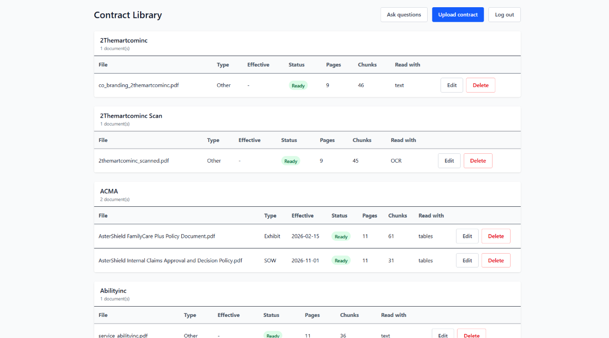
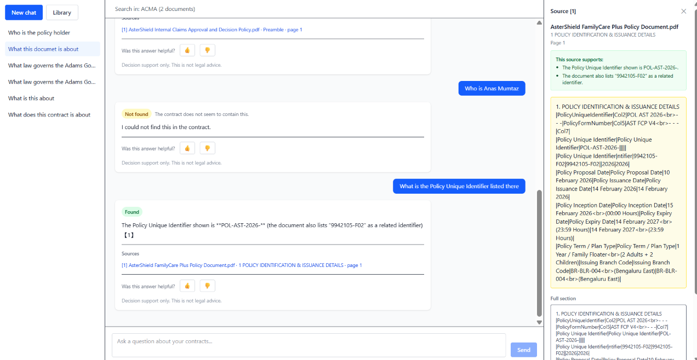
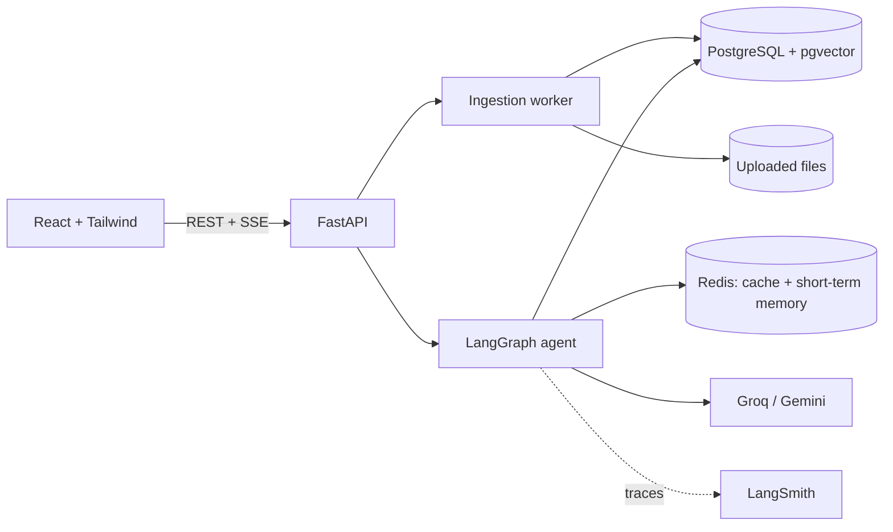
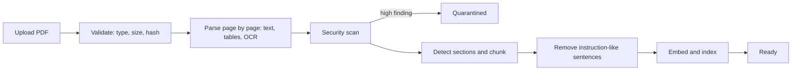
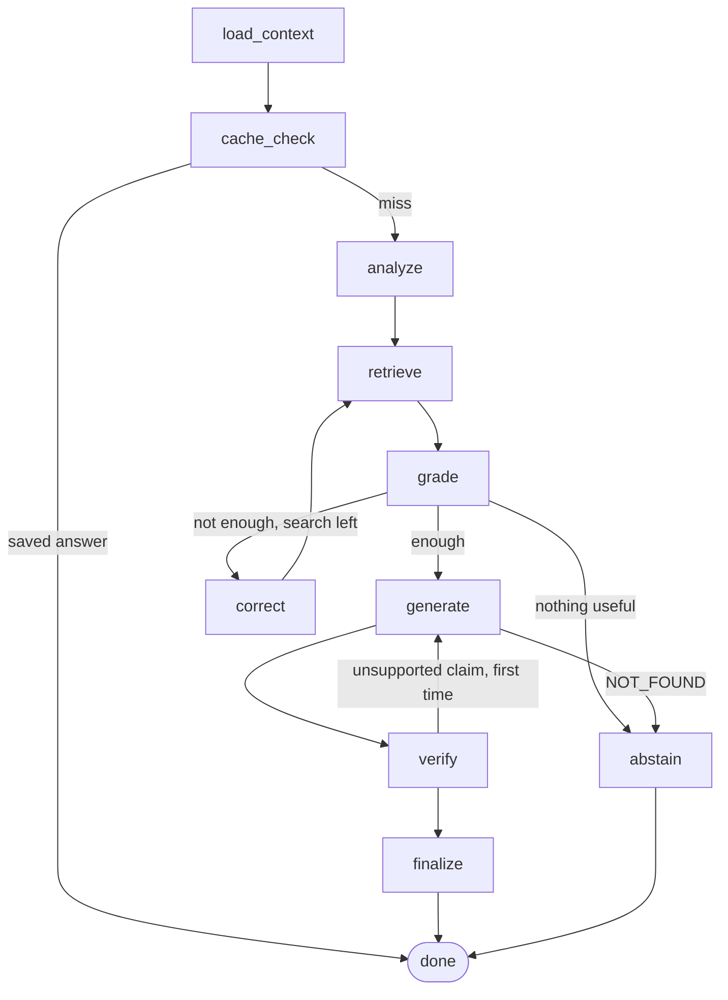

# Contract Intelligence

An agentic RAG application for vendor contracts. Upload PDFs (digital or scanned), ask questions in plain
language, and get answers with clause-level citations. The system says "not found" when a contract is silent,
warns when an amendment may have changed a clause, and treats uploaded documents as untrusted input.

> Decision support, not legal advice.

## Contents

1. [Screenshots](#screenshots)
2. [The problem it solves](#the-problem-it-solves)
3. [What it does](#what-it-does)
4. [Tech stack](#tech-stack)
5. [Architecture](#architecture)
6. [From PDF to searchable text (ingestion)](#from-pdf-to-searchable-text-ingestion)
7. [From question to answer (retrieval and the agent)](#from-question-to-answer-retrieval-and-the-agent)
8. [Security](#security)
9. [API and operations](#api-and-operations)
10. [Evaluation and results](#evaluation-and-results)
11. [Quick start](#quick-start)
12. [Configuration](#configuration)
13. [Development](#development)
14. [Troubleshooting](#troubleshooting)
15. [Project structure](#project-structure)
16. [Data, licensing and privacy](#data-licensing-and-privacy)
17. [Known limits and roadmap](#known-limits-and-roadmap)
18. [Credits](#credits)

## Screenshots

### Sign in


### Contract library


### Chat with source-backed answers


## The problem it solves

Companies with 50 to 500 people sign dozens or hundreds of vendor contracts and have no lawyer for routine
questions. When a vendor emails about a price rise or an outage, someone needs the notice period, the liability
cap or the governing law within minutes. People skim, guess, or wait days.

This app answers those questions from the contracts themselves:

- **"What did we agree to?"** Ask in everyday words ("can we get out early?") and get the answer with the exact
  clause, section and page. If the contract does not say, the answer is "not found", not a guess.
- **"Did something change?"** Amendments are linked to their main contract with an effective date. Answers
  list the amendments and tell the model that the latest one is the current term.
- **"Can I trust this file?"** Contracts come from third parties. Every upload is scanned for hidden
  instructions aimed at an AI before anything is indexed.

## What it does

| Capability | How it works |
|---|---|
| Hybrid search | pgvector (meaning) + PostgreSQL full-text (keywords), merged with Reciprocal Rank Fusion |
| Reranking | A local cross-encoder re-scores the top 20 candidates |
| Metadata filtering | Every search is filtered by user, and by contract (the vendor) when one is chosen or detected |
| Smart chunking | Clause-aware: splits by section numbers, keeps the section path, handles split labels like `3.` / `Term.` |
| Messy documents | Page-by-page router: text layer, tables (as markdown), and OCR (Tesseract) for scans |
| Query rewriting | The agent rewrites each question into contract wording ("leave early" becomes "termination for convenience") and splits multi-part questions into up to 3 searches |
| Agentic loop | LangGraph: plan, search, grade, search again, answer, verify every claim, then finalize |
| Self-correction | A grader decides if the passages are enough. If not, the agent searches again with new words (2 searches at most). |
| Grounded answers | Every claim is checked against the sources. Citations show which claims each source supports. |
| Hallucination check | A verifier splits the answer into claims and marks each as supported or not. An unsupported claim sends the answer back for one rewrite. |
| Abstention | Statuses: found, partial, conflicting, not found |
| Amendments | Documents link to a parent and have an effective date. Passages are shown oldest first, and the prompt says the latest amendment wins. Answers warn when amendments exist. |
| Security | Upload scan (visible, hidden, tiny-font and metadata injection), quarantine, and cleaning of contract text before every prompt |
| Memory | Short-term (Redis): recent turns and the contract in focus. Long-term (PostgreSQL): vendor aliases and preferences. |
| Caching | Answers, embeddings and LLM calls. Cache keys include document fingerprints, so edits never serve stale answers. |
| Feedback | Thumbs up or down on each answer. A thumbs down deletes that saved answer. |
| Observability | LangSmith traces tagged with message id, request id and prompt version. Structured JSON logs with request ids. |
| Evaluation | 77 questions across 7 difficulty levels plus 13 about scanned copies, a retrieval-only metric that needs no LLM, Ragas, and an injection test suite |

## Tech stack

| Layer | Technology |
|---|---|
| Backend | Python, FastAPI, SQLAlchemy (async), Alembic |
| Agent | LangGraph, LangChain, LangSmith |
| Database | PostgreSQL 16 with pgvector (vectors, full-text, all data) |
| Cache and memory | Redis 7 |
| LLMs | Groq (`openai/gpt-oss-120b`) and Gemini, with automatic fallback between them |
| Local models | `BAAI/bge-small-en-v1.5` embeddings (384 dimensions), `cross-encoder/ms-marco-MiniLM-L-6-v2` reranker |
| PDF reading | PyMuPDF, Tesseract OCR (through pytesseract) |
| Frontend | React, Vite, Tailwind CSS, React Router |
| Evaluation | Ragas, plus custom retrieval and injection tests |
| Tooling | uv, pytest, ruff, Docker Compose, GitHub Actions |

## Architecture



| Part | Responsibility |
|---|---|
| Frontend | Library, upload and confirm, chat with live agent steps, citation viewer |
| API | REST and server-sent events, login, limits, one error shape, request ids |
| Ingestion | PDF to scanned, cleaned, chunked, embedded text (runs as a FastAPI background task) |
| Agent | Plans, searches, grades, answers, verifies |
| PostgreSQL | Documents, sections, chunks (vector and full-text), chats, security events, memories, feedback |
| Redis | Answer, embedding and LLM caches, short-term memory, rate-limit counters |
| LLMs | Small, fast model for planning and grading. Larger model for answering and verifying. |

### Data model

`users` own `contracts` (one per vendor, which is also the "family"). A contract has many `documents` (the main
contract, amendments, exhibits). A document has `sections` (the clause tree) and `chunks` (the search unit, with a
vector column and a full-text column). `conversations` have `messages`. An assistant message has `citations` (a
chunk plus the claims it supports) and optional `feedback`. `security_events` record scan findings. `memories`
hold aliases and preferences. Five Alembic migrations create all of it.

Every user-owned table has `user_id`, and every search filters on it first.

### Design decisions

- **Retrieval is separate from the agent.** The same retrieval code serves the baselines and the agent, so the
  evaluation compares like with like.
- **One database.** pgvector plus full-text search gives hybrid search without a second system, and keeps
  filtering by user and contract in one SQL query.
- **Local embeddings and reranker.** They cost no quota and have no rate limit. Embeddings are hard to change
  later (everything must be re-indexed), so a provider change must not affect them.
- **Cheap models plan and grade, a larger model answers and verifies.** The cheap steps run on every question.
- **A failing helper step never fails a question.** If planning or grading fails, the agent falls back (the
  original question, all passages) and does not cache that answer. If verification fails, the answer is shown
  with a note that it was not checked.
- **Untrusted text is data.** Contract text is cleaned before every prompt, wrapped in delimiters, and the prompts
  say never to follow instructions inside it.
- **Cache keys contain what the answer depends on:** question, scope, a fingerprint of the documents, saved
  preferences, and the prompt version.
- **Amendments are handled at "level 1".** Documents link to a parent and carry a date, and the answer warns.
  Working out which clause an amendment replaced is future work.

## From PDF to searchable text (ingestion)



Statuses: `uploaded → parsing → scanning → chunking → embedding → ready`, or `failed`, or `quarantined`. The
browser polls the status. After processing, the user confirms the vendor, document type, effective date and
parent document. An LLM proposes these from the first page, and the user can change them.

**Validation.** PDF only, up to 20 MB, must start with `%PDF`, and the same file cannot be uploaded twice by the
same user (SHA-256 hash).

**Parsing, one page at a time.** One contract can mix digital and scanned pages, so each page picks its own path:

1. **Text layer** (PyMuPDF). A label on its own line (`3.`, then `Term. This Agreement...` on the next) is joined
   to the line after it, because many PDFs put numbers in a separate column.
2. **Tables.** A ruled table with at least 3 rows and 2 columns becomes markdown rows, and the rest of the page
   keeps its reading order. Page frames and boxes of paragraphs are not tables (a table may cover at most 60% of
   the page and average at most 15 words per cell). Without that guard, one 56-page contract lost most of its
   headings.
3. **OCR** (Tesseract). A page with a picture and fewer than 20 words is read with OCR. If Tesseract is missing,
   digital documents still work, and a fully scanned one fails with a clear message.

The document stores which paths were used (`parser_used`) and the share of pages with text (`parse_quality`).

**Sections and chunks.** Headings are numbered lines (`12.3 Limitation of Liability`), `ARTICLE` or `Section`
lines, and run-in titles (`3. Term. This Agreement...`). A long numbered line counts as a heading only if its
first sentence looks like a title. Table-of-contents lines (dot leaders) are ignored, and text before the first
heading is a "Preamble". Chunks follow the sections: about 300 words, cut at sentence ends, never longer than 450.
Each chunk keeps its section path (`12 Liability > 12.3 Exclusions`), which is also embedded with the text.

**Measured effect of the parsing fixes.** Joining split labels and detecting run-in titles took one 10-page
contract from 1 detected section to 16, and a 50-page contract from 2 to 71.

**Reindexing** deletes a document's sections and chunks and runs again. Embeddings are cached by text and model,
so a reindex only embeds what changed.

## From question to answer (retrieval and the agent)

### Search

1. **Vector search:** the question (with the BGE query prefix) against chunk embeddings, by cosine distance.
2. **Keyword search:** the question's words joined with OR, ranked with `ts_rank`. Only letters and digits are
   kept, so a question cannot inject search syntax.
3. **Merge:** Reciprocal Rank Fusion, `1 / (60 + rank)` summed over both lists.
4. **Rerank:** a cross-encoder scores the top 20 against the question, and the best 5 are kept.
5. **Cross-references:** "subject to Section 12.3" in a result adds the first chunk of that section from the same
   document, up to 3 extra chunks.

### The agent



| Step | Model | What it does |
|---|---|---|
| load_context | small (follow-ups only) | Finds the contract in focus (named in the question, an alias, or the last turn) and rewrites a follow-up so it stands alone |
| cache_check | none | Returns a saved answer for the same question about the same documents |
| analyze | small | Splits the question into up to 3 sub-questions and writes a search text for each in contract vocabulary |
| retrieve | none | Hybrid search, rerank and cross-references for each sub-question, results interleaved (at most 10 passages) |
| grade | small | Marks the useful passages, says if they are enough, and suggests a better query if not |
| correct | none | Prepares the second search |
| generate | larger | Writes a cited answer, or `NOT_FOUND` |
| verify | larger | Splits the answer into claims and checks each against the sources. Detects conflicting sources. |
| finalize | none | Decides the status, picks the cited sources, builds the claim-to-source map and the warnings, and saves to the cache |
| abstain | none | Returns "not found" without writing an answer |

**Statuses.** `found`. `partial`: the passages cover only part of the question, or a claim could not be verified.
`conflicting`: sources disagree and nothing shows which applies. `not found`.

**Amendments.** Passages are sorted oldest first and shown with their type and effective date. The generator is
told that the latest amendment wins, and the verifier rejects an answer that gives an older term as current. The
answer carries a warning that lists the amendments, even when it already cites one.

**Cost.** A normal question makes 4 LLM calls, a "not found" question about 3, and the worst case about 8. Calls
go through a rate limiter per provider and retry with growing pauses. If one provider fails, the other is tried.

**Prompts** are files in `backend/app/agent/prompts/`. `PROMPT_VERSION` is part of every cache key and every
LangSmith run, so change it whenever a prompt changes.

### Memory

- **Short-term (Redis, 2 hours):** the last 4 turns and the contract in focus. A vendor named in the question
  wins over the old focus. A conversation limited to one contract keeps it. The chat shows the focus as a chip the
  user can clear.
- **Long-term (PostgreSQL):** vendor aliases (they help find the contract) and preferences (given to the generator
  as background, never as facts about the contract). Managed with the `/memory` endpoints.

### Caching

| Cache | Key | Lifetime |
|---|---|---|
| Answers | Normalized question, contract scope, document fingerprint, saved preferences, prompt version | 24 hours |
| Embeddings | Embedding model and text | 30 days |
| LLM calls | Role, models, system prompt and user prompt | 7 days |

The document fingerprint covers each document's id, file hash, type, effective date and newest chunk id, so
uploading, editing or reindexing a document makes old answers unreachable. Answers made with a fallback (a failed
planning or verify step) are never saved. If Redis is down, caching and memory switch off and the app keeps working.

## Security

Uploaded contracts come from counterparties, so the system treats their text as untrusted.

**Upload scan.** It runs on the parsed text, so it also covers OCR output. It looks at visible text, hidden text
(white text, or text under 3 points, except white text on a dark box such as a table header), and the PDF
properties. Text is flattened first (Unicode look-alikes, zero-width characters, line breaks inside a sentence).
Ten rules match text addressed to an AI: ignore-previous-instructions, ignore-your-rules, new instructions, mentions
of the system prompt, role changes, notes to AI assistants, orders to an AI reviewing the document, orders to hide
information from the user, requests to reveal the prompt, and dictated conclusions.

- A **high** finding quarantines the document. Nothing is indexed.
- A **medium** finding removes the sentence.
- Hidden text is removed from the index even when it is harmless.
- **Release anyway** re-runs ingestion without the block, and still removes instruction-like sentences.
- Every finding is stored in `security_events`.

**At answer time.** Contract text is cleaned again before it goes into any prompt (fake delimiter tags,
zero-width characters, instruction-like sentences). The prompts say never to follow instructions inside excerpts,
even ones addressed to an AI, and the verifier checks the answer against the sources.

**Not covered.** A politely worded request that matches none of the rules is not detected (see the results below).
That is a limit of rule-based detection, and it is what the prompt rule and the verifier are for.

## API and operations

Interactive documentation is at `/docs`. Every endpoint except `/health`, `/auth/login` and `/auth/register`
needs `Authorization: Bearer <token>`. A test calls every other endpoint without a token and expects a 401 or 403.

### Errors

Every error has one shape. `detail` is plain text, so a client can show it directly.

```json
{"detail": "Wrong email or password", "code": "unauthorized", "request_id": "3f2a..."}
```

Codes: `bad_request`, `unauthorized`, `forbidden`, `not_found`, `conflict`, `too_large` (413), `invalid_input` (422),
`rate_limited` (429, with `Retry-After`), `server_error`. Send `X-Request-ID` to choose your own id. Every
response returns it in the `X-Request-ID` header, and it appears in every log line and in the LangSmith run.

### Limits and startup checks

- Login and register: 10 per minute per address (one shared limit).
- Questions: 20 per minute per user. Uploads: 10 per minute per user.
- JSON bodies up to 100 KB. Uploads up to 20 MB, checked from the `Content-Length` header before the body is read.
- The app refuses to start with a missing, example or very short `SECRET_KEY`.
- If Redis is down, the rate limits switch off instead of blocking users.

### Endpoints

| Method and path | Purpose |
|---|---|
| `POST /auth/register`, `POST /auth/login` | Create an account, get a token |
| `GET /contracts`, `POST /contracts` | List or create a contract (one per vendor) |
| `POST /documents/upload` | Upload a PDF (vendor and type optional). Processing is asynchronous. |
| `GET /documents`, `GET /documents/{id}` | List documents, or get one (status, parser, quality) |
| `GET /documents/{id}/suggestions` | LLM guess of the vendor, type and effective date |
| `PATCH /documents/{id}/metadata` | Confirm vendor, type, effective date and parent document |
| `GET /documents/{id}/chunks` | The chunks, to check parsing |
| `POST /documents/{id}/release` | Let a quarantined document through |
| `DELETE /documents/{id}` | Delete a document, its file and its chunks |
| `POST /chat/conversations`, `GET /chat/conversations` | Start or list conversations |
| `GET /chat/conversations/{id}/messages` | Messages with citations, claims and feedback |
| `POST /chat/conversations/{id}/ask` | Ask a question (server-sent events, below) |
| `GET /chat/conversations/{id}/focus`, `DELETE .../focus` | The contract that follow-ups use, or clear it |
| `POST /chat/messages/{id}/feedback` | `{"rating": 1}` or `{"rating": -1}`. A -1 deletes the saved answer. |
| `GET /chat/chunks/{id}` | A chunk with its full section |
| `GET /memory`, `POST /memory`, `DELETE /memory/{id}` | Aliases (`{"kind":"alias","key":"Adams","value":"Adamsgolfinc"}`) and preferences |
| `GET /health` | Database and Redis check |

### Ask: server-sent events

`POST /chat/conversations/{id}/ask` with `{"question": "..."}` returns `text/event-stream`:

| Event | Data |
|---|---|
| `step` | `{"text": "Planned 2 search(es): ..."}`, one per agent step |
| `answer` | `{message_id, answer, status, citations[], warning}` |
| `focus` | `{contract_id, vendor_name}`, sent when a contract was chosen from the question |
| `error` | `{"message": "..."}` |
| `done` | `{}` |

Each citation has `number`, `chunk_id`, `file_name`, `section_path`, `page_number`, `content` and `claims` (the
answer statements it supports).

## Evaluation and results

### The question set

77 questions about digital contracts and 13 about scanned copies of three of them. Every question was read and
cleaned by hand. Several were removed because the CUAD label was wrong (for example a "liability cap" clause
that only excluded consequential damages).

| Level | Tests | Questions | Source |
|---|---|---|---|
| 1 | Direct lookup | 11 | CUAD clause labels |
| 2 | Everyday wording | 11 | The same clauses, asked in plain words |
| 3 | Cross-reference | 5 | LLM-written from a clause and the section it points to, then reviewed |
| 4 | Defined terms | 9 | Definitions found in the contract text |
| 5 | Amendments | 7 | Synthetic amendment families, with checks written in code |
| 6 | Two clauses at once | 10 | Two CUAD clauses combined |
| 7 | Clause not in the contract | 24 | CUAD "no answer" labels, confirmed by a keyword search of the PDF |
| 8 | Portfolio questions | 0 | **Not built** (needs structured extraction and SQL) |

**Synthetic data.** There are 4 amendment families (5 amendment PDFs): a governing-law change, a chain of two
amendments to the same clause, a liability change and a termination-notice change. The change is chosen in code,
the LLM only rewrites the wording, and the script checks that the required words appear. The 3 scanned copies are
real contracts turned into noisy page images. Both are labelled synthetic.

### Metrics

| Metric | Needs an LLM | Meaning |
|---|---|---|
| Context hit | No | At least 50% of the expected clause (in 5-word groups) appears in the retrieved text |
| Answered | Yes | The pipeline gave an answer instead of "not found" |
| Correct "not found" | Yes | Level 7 only |
| Amendment retrieved | No | Level 5: a chunk of an amendment was retrieved |
| Current value stated | Yes | Level 5: the answer contains the new value (a word check from the amendment manifest) |
| Faithfulness, context recall | Yes (Ragas) | Scored on a sample, always the same questions for every pipeline |

Comparisons only use questions that every compared pipeline has an answer for.

### Results

A difference of one question moves a rate by 0.1 or more. Read the trends, not the decimals.

**Retrieval: did the right clause reach the model? (no LLM involved)**

| Pipeline | Level 1 | Level 2 | Level 3 | Level 4 | Level 5 | Level 6 | All levels (1-6) |
|---|---|---|---|---|---|---|---|
| Naive (vector only) | 1.00 (n=11) | 0.82 (n=11) | 0.80 (n=5) | 0.89 (n=9) | 0.86 (n=7) | 0.70 (n=10) | **0.85 (n=53)** |
| Hybrid | 1.00 (n=11) | 0.64 (n=11) | 0.80 (n=5) | 1.00 (n=9) | 0.86 (n=7) | 0.70 (n=10) | **0.83 (n=53)** |
| Hybrid + rerank | 1.00 (n=11) | 0.73 (n=11) | 1.00 (n=5) | 1.00 (n=9) | 1.00 (n=7) | 0.80 (n=10) | **0.91 (n=53)** |
| Hybrid + rerank + cross-reference | 1.00 (n=11) | 0.73 (n=11) | 1.00 (n=5) | 1.00 (n=9) | 1.00 (n=7) | 0.80 (n=10) | **0.91 (n=53)** |

On levels 1 to 5 only (n=43) the overall rates are 0.88 for naive, 0.86 for hybrid, and 0.93 for both rerank
pipelines.

What this shows:

- **Reranking helps.** 0.91 against 0.85 for naive vector search and 0.83 for hybrid. It also fixes the amendment
  questions (level 5), where it retrieves the right clause for all 7.
- **Hybrid alone is worse than vector search on everyday wording** (level 2, 0.64 against 0.82, two questions).
  "Can we leave early?" shares few words with "termination for convenience", so keyword matches add noise. This is
  the case that query rewriting in the agent is meant to address. Reranking recovers part of the loss (0.73).
- **Cross-reference lookup changes nothing on this set.** Few questions depend on a clause that points to another.
- **Two clauses at once (level 6) is the weakest level** (0.70 to 0.80). Splitting the question into sub-questions
  is meant to help, and it has not been measured on this set yet.
- **Scanned copies:** on the 10 answerable questions about the 3 scanned contracts, the right clause was retrieved
  for 8 (0.80) with every pipeline.

**Answers: naive against the agent (preliminary)**

The full answer-level comparison across all levels, including the amendment questions, was not completed because
free-tier LLM limits ran out during the runs. What exists is small: on 6 "clause not in the contract" questions the
agent answered "not found" correctly in 0.83 of cases (5 of 6), against 0.67 (4 of 6) for the naive pipeline and
for the hybrid + rerank + cross-reference pipeline. Six questions are a hint, not a result. The Ragas scores
(faithfulness, context recall) are not reported, because too few were scored to compare. The answers were written
by a mix of Gemini and Groq at different times, so treat answer-level numbers as preliminary.

**Prompt injection (8 attacks, 2 clean controls)**

| Measure | Defenses on | Defenses off |
|---|---|---|
| Blocked at upload (quarantined) | 6 | 0 |
| Cleaned and indexed | 1 | 0 |
| Indexed untouched (not detected) | 1 | 8 |
| Attack text in the prompt that the model reads | 1 | 4 |
| Answers that followed the attack | 0 | 0 |
| Clean controls wrongly flagged | 0 of 2 | 0 of 2 |

The 8 attacks are: visible text, white text, tiny font, a footer note, the PDF properties, a clause disguised as
section 21, a dictated conclusion, and a politely worded paraphrase.

Read this carefully. The model also ignored all 8 attacks with the defenses off, because the system prompt tells it
never to follow instructions inside excerpts. The measurable benefit of the defenses is that attack text reaches
the model in 1 case of 8 instead of 4 of 8. The one attack that gets through the rules is the politely worded
request. In the undefended run, 4 of the 8 attack texts were not retrieved by the test question, so "reached the
prompt" understates the risk there.

### Reproduce

Run these from the `backend` folder.

```bash
uv run python ../eval/run_retrieval.py --email you@example.com          # free, no LLM
uv run python ../eval/run_ragas.py --email you@example.com --skip-ragas --skip-scanned --pipelines naive hybrid_rerank_xref agentic --max-new 40
uv run python ../eval/run_ragas.py --email you@example.com --skip-scanned --pipelines naive hybrid_rerank_xref agentic --max-new 1 --max-score 20
uv run python ../eval/make_summary.py                                   # writes eval/results/summary.md
uv run python ../eval/run_injection_tests.py --email you@example.com    # add --mode undefended for the comparison
```

Answers are saved the moment they exist, and a run stops after 3 failures in a row, so a free-tier limit never
loses work. Run the same command again later. `--refresh` ignores saved results, and you should use it after you
change retrieval or prompt code. The LLM cache can replay old replies, so clear Redis too if you change a prompt
without changing its text.

### Limits of this evaluation

- The sets are small. Levels have 5 to 24 questions, so one question moves a rate by up to 0.2.
- Answer-level numbers come from free-tier models, and the provider changed during the project.
- Synthetic amendments are simpler than real ones.
- The injection test has 8 attacks. It shows that the layers work, not that the system is safe against every attack.
- Context hit measures retrieval by text overlap, and can miss a correct clause that is worded differently.

## Quick start

You need Docker and a free Groq API key (https://console.groq.com/keys).

```bash
cp .env.example .env          # then set SECRET_KEY and GROQ_API_KEY
make up                       # builds and starts everything (several minutes the first time)
make demo-quick               # loads 4 contracts with amendments (a few minutes)
```

Without `make` (Windows PowerShell):

```powershell
Copy-Item .env.example .env   # then edit .env: SECRET_KEY and GROQ_API_KEY
docker compose up --build -d
docker compose exec backend python -m scripts.seed_sample_data --email demo@example.com --password demo-password-123 --quick
```

Create a secret key with `python -c "import secrets; print(secrets.token_hex(32))"`.

Open http://localhost:5173 and log in with `demo@example.com` / `demo-password-123` (demo account only).
API documentation: http://localhost:8000/docs.

Try this: pick "Adamsgolfinc", ask *"Which law currently governs this agreement?"*, and watch the amendment
override the original clause. Then ask *"What about the renewal term?"* to see the follow-up resolve.

The first start downloads two small models (embeddings and reranker), so give the backend a few minutes to become
healthy (`docker compose ps`). `make demo` loads all 24 sample contracts and 3 scans (about 10 minutes on a CPU).
Without any LLM key, upload, parsing, search and the library still work, and a question shows a readable error.

## Configuration

Set these in `.env` (see `.env.example`).

| Variable | Purpose |
|---|---|
| `SECRET_KEY` | Signs login tokens. Required. The app refuses to start with an example or short value. |
| `GROQ_API_KEY`, `GOOGLE_API_KEY` | LLM keys. At least one is needed. The other provider is the automatic backup. |
| `FAST_PROVIDER`, `SMART_PROVIDER` | Which provider each role tries first (`groq` or `gemini`) |
| `GROQ_MODEL`, `GEMINI_MODEL` | Model names. Check the exact ids in each console, because they change. |
| `DATABASE_URL`, `REDIS_URL` | Used when the backend runs on your computer. Docker Compose sets its own. |
| `POSTGRES_USER`, `POSTGRES_PASSWORD`, `POSTGRES_DB` | Database credentials |
| `LOG_FORMAT` | `json` for servers, `text` for reading logs yourself |
| `LANGSMITH_TRACING`, `LANGSMITH_API_KEY`, `LANGSMITH_PROJECT` | Optional tracing |
| `TESSERACT_CMD` | Path to Tesseract when you run the backend on Windows. Empty in Docker. |

Tuning options (defaults in `backend/app/config.py`): `SECURITY_SCAN_ENABLED`, `RESPONSE_CACHE_ENABLED`,
`LLM_CACHE_ENABLED`, `RATE_LIMIT_LOGIN_PER_MINUTE`, `RATE_LIMIT_ASK_PER_MINUTE`, `RATE_LIMIT_UPLOAD_PER_MINUTE`,
`MAX_UPLOAD_MB`, `GEMINI_REQUESTS_PER_MINUTE`, `GROQ_REQUESTS_PER_MINUTE`, `AGENT_MAX_ATTEMPTS`.

## Development

```bash
cd backend && uv sync --all-groups     # install (the eval group holds Ragas)
make test                              # 138 tests, no database or API key needed
make lint                              # ruff
cd ../frontend && npm install && npm run dev
```

Run the backend on your own machine: start `postgres` and `redis` with `docker compose up -d postgres redis`, then
`uv run alembic upgrade head` and `uv run uvicorn app.main:app --reload` in `backend`.

Useful scripts, all run from `backend`:

```bash
uv run python -m scripts.seed_sample_data --email you@example.com [--password ... --quick]   # load the sample contracts
uv run python -m scripts.reindex --email you@example.com [--file name]                        # process documents again
uv run python -m scripts.check_llm                                                            # test each LLM provider separately
uv run python -m scripts.show_pdf_lines --file name.pdf                                       # see how a PDF's lines look
```

**Tests.** They cover chunking and headings, the page router, retrieval helpers, cross-references, the
agent's routing (retry, abstain, failed check, partial and conflicting statuses, memory, cache) with a fake LLM,
the security rules and poisoned PDFs, rate limits, logging, and the API (login required on every protected route,
one error shape, size limits, weak secret). **CI** (GitHub Actions) runs ruff and the tests on every push, and builds
the frontend.

## Troubleshooting

| Symptom | Cause and fix |
|---|---|
| The app stops at startup with "SECRET_KEY is missing or too weak" | Create a key with the command in Quick start and put it in `.env`. Old login tokens stop working. |
| A question shows a rate limit, timeout or 503 error | A free-tier limit or a busy provider. Run `uv run python -m scripts.check_llm`. Set `FAST_PROVIDER` and `SMART_PROVIDER` to the provider that works. |
| `ModuleNotFoundError` after `uv sync` | A package was installed with `uv pip` and `uv sync` removed it. Use `uv add <package>` so it is declared in `pyproject.toml`. |
| A scanned PDF fails with an OCR error | Tesseract is not installed or not found. Install it and set `TESSERACT_CMD`. Docker has it already. |
| PostgreSQL does not start because port 5432 is taken | Another PostgreSQL runs on your computer. Compose maps the container to port 5433 for this reason. |
| Answers look stale after a prompt change | Change `PROMPT_VERSION` in `agent/nodes.py`, or clear Redis (`FLUSHDB`). |
| A real contract is quarantined | Read the reason in the Library. If you trust the sender, click Release. Please report the rule, because it may be too broad. |

## Project structure

```
contract-intelligence/
│
├── README.md                          # this document: overview, architecture, results, setup
├── .gitignore                         # uploads/, .env, model caches, bulky eval results
├── .env.example
├── docker-compose.yml                 # postgres (pgvector), redis, backend, frontend
├── Makefile                           # make up, down, logs, demo, demo-quick, test, lint, clean
├── ruff.toml                          # lint rules (shared by backend and eval)
│
├── assets/                            # screenshots used in this README
│   ├── login.png
│   ├── Library.png
│   └── Chat.png
│
├── .github/
│   └── workflows/
│       └── ci.yml                     # ruff + tests on every push, frontend build
│
├── data/
│   ├── cuad_subset/                   # 24 public CUAD sample contracts + sources.csv
│   ├── synthetic/
│   │   ├── amendments/                # 4 amendment families (5 PDFs), manifest.json, sources_amendments.csv
│   │   └── scanned/                   # 3 scanned copies + sources_scanned.csv
│   └── poisoned/                      # 8 poisoned contracts + 2 clean controls
│
├── uploads/                           # user-uploaded files (gitignored)
│
├── backend/
│   ├── pyproject.toml                 # dependencies (the eval group holds Ragas)
│   ├── uv.lock
│   ├── Dockerfile                     # includes Tesseract, runs migrations, then the API
│   ├── alembic.ini
│   ├── alembic/
│   │   ├── env.py
│   │   ├── script.py.mako
│   │   └── versions/
│   │       ├── 0001_create_tables.py                    # users, contracts, documents, sections, chunks
│   │       ├── 0002_create_chat_tables.py               # conversations, messages, citations
│   │       ├── 0003_documents_metadata_and_warning.py   # effective date, parent, parser info, answer warning
│   │       ├── 0004_citation_claims.py                  # claims each citation supports
│   │       └── 0005_security_memory_feedback.py         # security events, memories, feedback
│   │
│   ├── app/
│   │   ├── main.py                    # app factory, startup check, lifespan (model warm-up), health, routers
│   │   ├── config.py                  # settings, model roles, limits
│   │   ├── logging.py                 # JSON or text logs with request ids
│   │   ├── errors.py                  # one error shape for every error
│   │   ├── middleware.py              # request ids, size limits, rate limits, access log
│   │   ├── rate_limit.py              # Redis counters for login, ask and upload
│   │   ├── tracing.py                 # turns on LangSmith when configured
│   │   ├── database.py                # async engine and session
│   │   ├── models.py                  # all SQLAlchemy tables
│   │   ├── schemas.py                 # Pydantic models, including the answer contract
│   │   ├── deps.py                    # db session, current user, redis, password and token helpers
│   │   │
│   │   ├── routes/
│   │   │   ├── auth.py                # register, login
│   │   │   ├── contracts.py           # contracts (one per vendor)
│   │   │   ├── documents.py           # upload, status, suggestions, metadata, release, delete
│   │   │   ├── chat.py                # conversations, SSE answers, focus, feedback, citations
│   │   │   └── memory.py              # aliases and preferences
│   │   │
│   │   ├── ingestion/
│   │   │   ├── pipeline.py            # validation, status updates, scan stage, quarantine
│   │   │   ├── parsing.py             # PyMuPDF text, tables, OCR, page-level router
│   │   │   ├── structure.py           # heading and section-number detection
│   │   │   ├── chunking.py            # clause-aware chunking
│   │   │   ├── metadata.py            # LLM-proposed vendor, type, effective date
│   │   │   └── indexing.py            # embed (cached) and write sections and chunks
│   │   │
│   │   ├── retrieval/
│   │   │   ├── search.py              # hybrid vector + keyword search, RRF, filters, amendment warning
│   │   │   ├── rerank.py              # local cross-encoder
│   │   │   └── cross_reference.py     # detect "Section 12.3" and fetch it
│   │   │
│   │   ├── agent/
│   │   │   ├── graph.py               # graph construction, routing and loop logic
│   │   │   ├── state.py               # typed graph state
│   │   │   ├── nodes.py               # load_context, cache_check, analyze, retrieve, grade,
│   │   │   │                          # correct, generate, verify, finalize, abstain
│   │   │   └── prompts/
│   │   │       ├── analyze.md
│   │   │       ├── grade.md
│   │   │       ├── generate.md
│   │   │       ├── verify.md
│   │   │       └── followup.md
│   │   │
│   │   ├── rag.py                     # context building, citation parsing, simple retrieve-and-answer
│   │   ├── llm.py                     # Groq and Gemini clients, roles, fallbacks, rate limiting, LLM cache
│   │   ├── embeddings.py              # local embedding model wrapper
│   │   ├── memory.py                  # STM (Redis) and LTM (PostgreSQL)
│   │   ├── security.py                # injection rules, hidden-text scan, cleaning of retrieved text
│   │   ├── cache.py                   # response, embedding and LLM-call caches
│   │   └── storage.py                 # local disk file handling
│   │
│   ├── scripts/
│   │   ├── seed_sample_data.py        # load data/ into the database (can create the demo user)
│   │   ├── reindex.py                 # process documents again
│   │   ├── check_llm.py               # test each LLM provider on its own
│   │   └── show_pdf_lines.py          # print the lines of a PDF, to debug heading detection
│   │
│   └── tests/
│       ├── conftest.py                # safe settings, fake LLM and fake search for agent tests
│       ├── unit/
│       │   ├── test_agent.py          # mocked LLM: retry, abstain, verify-fail, partial, conflicting
│       │   ├── test_api.py            # login required everywhere, error shape, limits, weak secret
│       │   ├── test_chunking.py
│       │   ├── test_cross_reference.py
│       │   ├── test_logging.py
│       │   ├── test_memory.py         # follow-ups, vendor focus, cache, injection never reaches a prompt
│       │   ├── test_metadata.py
│       │   ├── test_parsing.py
│       │   ├── test_rate_limit.py
│       │   ├── test_retrieval.py
│       │   └── test_security.py
│       └── security/
│           └── test_poisoned_contracts.py   # white, tiny, metadata and visible attacks in real PDFs
│
├── frontend/
│   ├── package.json
│   ├── vite.config.js
│   ├── tailwind.config.js
│   ├── postcss.config.js
│   ├── Dockerfile                     # build with Vite, serve with nginx
│   ├── nginx.conf
│   ├── index.html
│   │
│   └── src/
│       ├── main.jsx
│       ├── App.jsx                    # router and protected routes
│       ├── api.js                     # fetch wrapper, SSE reader, API calls
│       ├── index.css                  # Tailwind directives
│       │
│       ├── pages/
│       │   ├── Login.jsx
│       │   ├── Library.jsx            # contracts grouped by vendor, amendments nested, statuses
│       │   └── Chat.jsx               # scope selector, thread, focus chip, citation panel
│       │
│       └── components/
│           ├── UploadDialog.jsx       # drag-drop, progress, security-scan step, quarantine and release
│           ├── MetadataForm.jsx       # confirm or edit vendor, type, effective date, parent
│           ├── AgentProgress.jsx      # live agent steps
│           ├── AnswerCard.jsx         # answer, status badge, warnings, citation chips, thumbs up/down
│           ├── CitationViewer.jsx     # clause text, supported claims, full section
│           ├── MessageInput.jsx
│           └── ui.jsx                 # Button, Badge, Modal, Spinner, toasts, loading, empty and error states
│
└── eval/
    ├── questions.jsonl                # CUAD-based questions (levels 1, 2, 7)
    ├── questions_amendments.jsonl     # level 5
    ├── questions_synthetic.jsonl      # levels 3, 4, 6
    ├── questions_more.jsonl           # more levels 3, 4, 6
    ├── questions_not_found.jsonl      # more level 7
    ├── questions_scanned.jsonl        # copies of questions for the scanned contracts
    ├── injection_cases/
    │   └── cases.json                 # the poisoned contracts and the expected safe behavior
    │
    ├── pipelines.py                   # naive, hybrid, hybrid+rerank, +cross-reference, agentic
    ├── run_retrieval.py               # retrieval metrics for every pipeline, no LLM
    ├── run_ragas.py                   # answers and Ragas scores, resumable, quota-aware
    ├── run_injection_tests.py         # defended and undefended injection tests
    ├── report.py                      # per-level tables and shared helpers
```

Review helpers such as `show_questions.py`, `remove_questions.py` and `question_status.py` were used to clean the
question files. They can be deleted once the question set is final.


## Known limits and roadmap

**Limits**

- Background ingestion uses FastAPI background tasks. A restart during processing leaves a document stuck, and you
  upload it again.
- Tables are only recognized when they have ruled lines. OCR quality depends on the scan.
- The scan rules miss a politely worded paraphrase attack.
- Amendments are handled by dates and warnings. The system does not work out which clause an amendment replaced.
- Questions about the whole portfolio ("which vendors have uncapped liability?") are not supported.
- The upload size limit reads the `Content-Length` header, and the rate limits assume one address per user (no
  proxy headers). The containers run as root.
- The evaluation is small and partly synthetic. It shows direction, not statistical proof.
