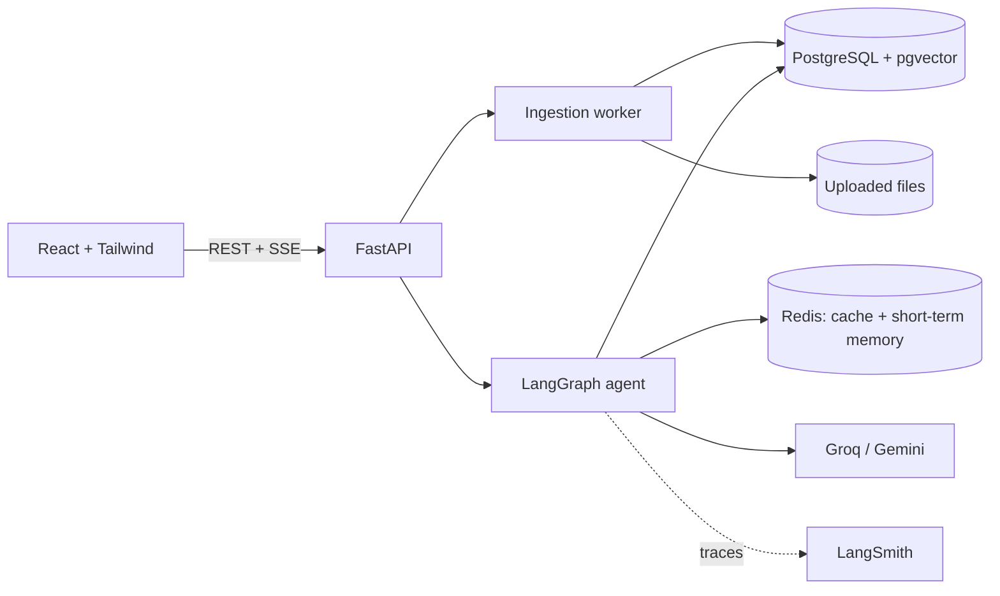

# Contract Intelligence

An agentic RAG application for vendor contracts. Upload PDFs (digital or scanned), ask questions in plain
language, and get answers with clause-level citations. The system says "not found" when a contract is silent,
warns when an amendment may have changed a clause, and treats uploaded documents as untrusted input.

> Decision support, not legal advice.


## What it does

| Capability | How it works |
|---|---|
| Hybrid search | pgvector (meaning) + PostgreSQL full-text (keywords), merged with Reciprocal Rank Fusion |
| Reranking | A local cross-encoder re-scores the top 20 candidates |
| Smart chunking | Clause-aware: splits by section numbers, keeps the section path, handles split labels like `3.` / `Term.` |
| Messy documents | Page-by-page router: text layer, tables (as markdown), and OCR (Tesseract) for scans |
| Agentic loop | LangGraph: plan, search, grade, search again, answer, verify every claim, then finalize |
| Self-correction | A grader decides if the passages are enough. If not, the agent searches again with new words. |
| Grounded answers | Every claim is checked against the sources. Citations show which claims each source supports. |
| Abstention | Statuses: found, partial, conflicting, not found |
| Amendments | Documents link to a parent and have an effective date. The newest amendment wins, and answers warn about amendments. |
| Security | Upload scan (visible, hidden, tiny-font and metadata injection), quarantine, and answer-time cleaning of contract text |
| Memory | Short-term (Redis): recent turns and the contract in focus. Long-term (PostgreSQL): vendor aliases and preferences. |
| Caching | Answers, embeddings and LLM calls. Cache keys include document fingerprints, so edits never serve stale answers. |
| Observability | LangSmith traces tagged with message id, request id and prompt version. Structured JSON logs with request ids. |
| Evaluation | 40 questions across 5 difficulty levels, a retrieval-only metric that needs no LLM, Ragas, and an injection test suite |

## Architecture



More in [docs/architecture.md](docs/architecture.md).

## Results

All numbers come from `eval/make_summary.py`. The sample sizes are small, so every cell shows its `n`.
A difference of one question moves a rate by 0.1 or more. Read the trends, not the decimals.


### Retrieval: Did the right clause reach the model? (No LLM involved)

| Pipeline | Level 1 | Level 2 | Level 3 | Level 4 | Level 5 | All levels (1–5) |
|---|---|---|---|---|---|---|
| Naive (vector only) | 1.00 (n=11) | 0.82 (n=11) | 0.80 (n=5) | 0.89 (n=9) | 0.86 (n=7) | **0.87 (n=43)** |
| Hybrid | 1.00 (n=11) | 0.64 (n=11) | 0.80 (n=5) | 1.00 (n=9) | 0.86 (n=7) | **0.84 (n=43)** |
| Hybrid + rerank | 1.00 (n=11) | 0.73 (n=11) | 1.00 (n=5) | 1.00 (n=9) | 1.00 (n=7) | **0.91 (n=43)** |
| Hybrid + rerank + cross-reference | 1.00 (n=11) | 0.73 (n=11) | 1.00 (n=5) | 1.00 (n=9) | 1.00 (n=7) | **0.91 (n=43)** |

### What this shows

- **Reranking helps:** 0.91 vs. 0.87 for naive vector search and 0.84 for hybrid. It also achieves perfect retrieval on Level 5 (amendment questions).
- **Hybrid alone performs worse than vector search on everyday wording (Level 2, 0.64 vs. 0.82).** A question like "can we leave early?" shares few words with the clause "termination for convenience", so keyword matches can introduce noise. This is the case that query rewriting in the agent is intended to address.
- **Cross-reference lookup adds nothing on this test set.** Few questions depend on clauses that point to other clauses.
- **Levels 3–5 achieve 0.80–1.00 with the best pipeline.** Level 2 remains the main weakness for hybrid retrieval, suggesting that everyday-language query interpretation needs improvement.


### Answers: naive vs agent

<!-- Paste the "Answers" table from results/summary.md here after the runs are complete. -->

Preliminary (6 "clause not in the contract" questions, so this is a hint, not a result): the agent answered
"not found" correctly in 0.83 of cases, against 0.67 for the naive pipeline. The full comparison, with
amendment questions (level 5), is in `results/summary.md`.

### Prompt injection (8 attacks, 2 clean controls)

| Measure | Defenses on | Defenses off |
|---|---|---|
| Blocked at upload (quarantined) | 6 | 0 |
| Cleaned and indexed | 1 | 0 |
| Indexed untouched (not detected) | 1 | 8 |
| Attack text in the prompt that the model reads | 1 | 4 |
| Answers that followed the attack | 0 | 0 |
| Clean controls wrongly flagged | 0 of 2 | 0 of 2 |

Read this carefully: the model also resisted the attacks with the defenses off, because the system prompt tells it
never to follow instructions inside excerpts. The measurable benefit of the defenses is that attack text reaches
the model in 1 of 8 cases instead of 4 of 8. One attack (a politely worded request) is not detected by the
rules. That is a known limit of rule-based detection. It is what the prompt rule and the answer verification
are for.

## Quick start

You need Docker and a free Groq API key (https://console.groq.com/keys).

```bash
cp .env.example .env          # then set SECRET_KEY and GROQ_API_KEY
make up                       # builds and starts everything (several minutes the first time)
make demo-quick               # loads 4 contracts with amendments (a few minutes)
```

Without `make` (Windows PowerShell):

```powershell
Copy-Item .env.example .env   # then edit .env: SECRET_KEY and GROQ_API_KEY
docker compose up --build -d
docker compose exec backend python -m scripts.seed_sample_data --email demo@example.com --password demo-password-123 --quick
```

Open http://localhost:5173 and log in with `demo@example.com` / `demo-password-123` (demo account only).
API documentation: http://localhost:8000/docs.

Try: pick "Adamsgolfinc", ask *"Which law currently governs this agreement?"*, and watch the amendment
override the original clause. Then ask *"What about the renewal term?"* to see the follow-up resolve.

The first start downloads two small models (embeddings and reranker). `make demo` loads all 24 sample
contracts and 3 scans (about 10 minutes on a CPU).

## Development

```bash
cd backend && uv sync --all-groups     # install
make test                              # 138 unit tests, no database or API key needed
make lint                              # ruff
cd ../frontend && npm install && npm run dev
```

Run the evaluation (see [docs/evaluation.md](docs/evaluation.md)):

```bash
cd backend
uv run python ../eval/run_retrieval.py --email you@example.com      # free, no LLM
uv run python ../eval/run_ragas.py --email you@example.com --skip-ragas --skip-scanned --pipelines naive agentic --levels 5 7
uv run python ../eval/make_summary.py
```

## Data and privacy

- Sample contracts come from **CUAD v1** (The Atticus Project, CC BY 4.0). Amendments and scanned copies are
  **synthetic**, made by scripts in `eval/`, and marked as such. See [data/README.md](data/README.md).
- **Use public or synthetic contracts only** with the free LLM tiers. Free Gemini data may be used by Google
  to improve its products in some regions, and LangSmith traces contain the question and contract excerpts.
  For private contracts, turn tracing off and use a paid tier or a local model.
- Uploaded files stay on your machine (Docker volume). Only text excerpts are sent to the LLM provider.

## Known limits

- Background ingestion uses FastAPI background tasks. A restart during processing leaves a document stuck, and
  you re-upload it. A job queue would fix this.
- Tables are only recognized when they have ruled lines. OCR quality depends on the scan.
- Questions about the whole portfolio ("which vendors have uncapped liability?") are not supported. They need a
  structured extraction step and SQL. This is the next planned feature (evaluation level 8).
- The containers run as root, and rate limits assume one address per user (no proxy headers).
- The evaluation is small (40 questions) and partly synthetic. It shows direction, not statistical proof.

## Repository layout

```
backend/app/   agent/ ingestion/ retrieval/ routes/ + security, memory, cache, llm, middleware
backend/tests/ unit and security tests (no network)
frontend/src/  pages/ components/
eval/          question builders, runners, report and summary scripts
data/          CUAD sample, synthetic amendments, scans, poisoned contracts
docs/          architecture, ingestion, retrieval, evaluation, api
```

## Credits

CUAD: Hendrycks et al., *CUAD: An Expert-Annotated NLP Dataset for Legal Contract Review* (The Atticus Project).